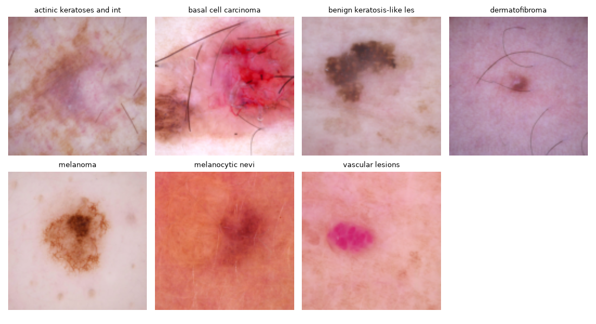
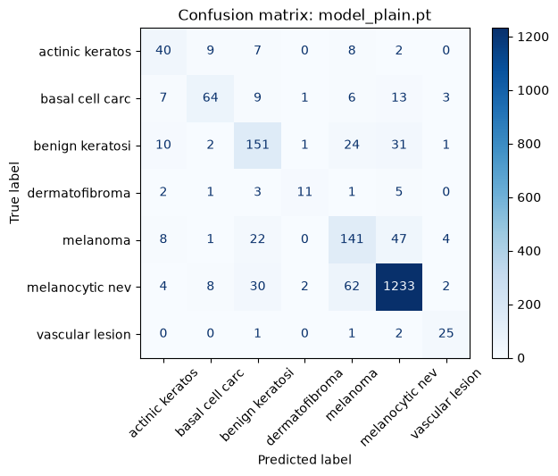
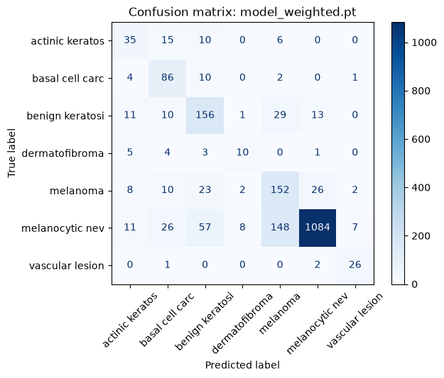
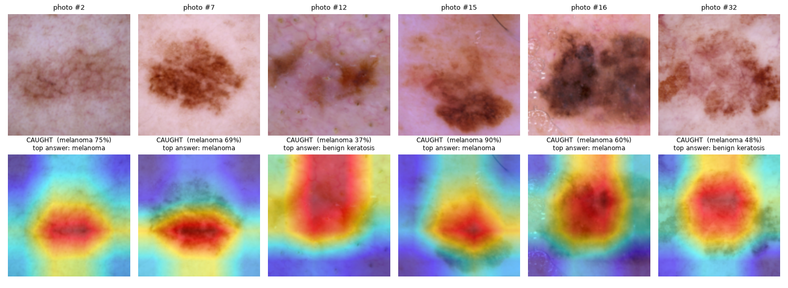
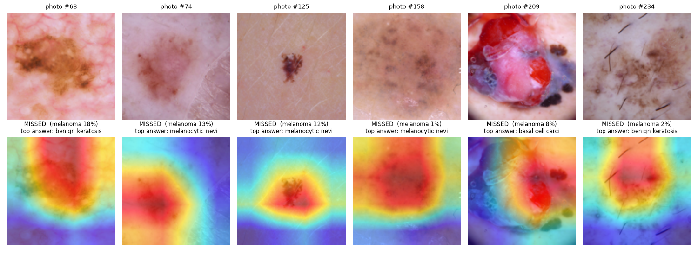

# SpotCheck: Evaluation Report

**Khadija Soua, Robin Harris Subiakno** · Introduction to AI, Winter Semester 2026

> [!IMPORTANT]
> SpotCheck is a student project, not a medical device. It must not be used for clinical decisions.

## Summary

We fine-tuned an ImageNet-pretrained ResNet-18 to classify dermatoscope images into seven
lesion classes and to flag suspected melanoma for dermatology referral. On the held-out test set
(n = 2,005), the unweighted model reaches **83.0% accuracy** against a majority-class baseline of
66.9%, but detects only **63.2% of melanomas**. Class-weighted training combined with a lowered
decision threshold of 0.20 raises **melanoma sensitivity to 80.3%**, at the cost of referring
20.1% of non-melanoma lesions. Most remaining false negatives are faint, small or atypical lesions.

| Model | Accuracy | Balanced acc. | Melanoma sensitivity | Melanoma PPV | False negatives | False positives |
|---|---|---|---|---|---|---|
| Baseline (always "naevus") | 66.9% | 14.3% | 0.0% | – | 223 | 0 |
| Plain | **83.0%** | 68.6% | 63.2% | **58.0%** | 82 | **102** |
| Weighted | 77.3% | **69.9%** | 68.2% | 45.1% | 71 | 185 |
| Weighted, threshold 0.20 | – | – | **80.3%** | 33.3% | **44** | 359 |

*False negatives and positives refer to melanoma (223 melanomas, 1,782 other lesions in the test set).
The threshold applies only to the melanoma referral decision, so accuracy is not reported for it.*

**Contents:**
[1 Setup](#1-experimental-setup) ·
[2 Data](#2-dataset-and-class-imbalance) ·
[3 Model selection](#3-model-selection) ·
[4 Overall performance](#4-overall-performance) ·
[5 Melanoma detection](#5-melanoma-detection) ·
[6 Per-class results](#6-per-class-results) ·
[7 Confusion matrices](#7-error-analysis-confusion-matrices) ·
[8 Decision threshold](#8-decision-threshold) ·
[9 Grad-CAM](#9-error-analysis-grad-cam) ·
[10 Limitations](#10-limitations) ·
[11 Future work](#11-future-work)

---

## 1. Experimental setup

| | |
|---|---|
| **Data** | DermaMNIST (MedMNIST v2), derived from HAM10000; 7 classes; 128 × 128 RGB |
| **Splits** | Official: 7,007 train · 1,003 validation · 2,005 test |
| **Model** | ResNet-18, ImageNet-pretrained; final layer replaced by a 7-way linear layer; all layers fine-tuned |
| **Training** | 5 epochs · batch size 64 · Adam, learning rate 1e-4 · cross-entropy loss · random horizontal and vertical flips |
| **Model selection** | Epoch with the highest validation balanced accuracy |
| **Testing** | Test set used once, after all modelling and threshold decisions were fixed |

Two variants were trained: **plain** (unweighted loss) and **weighted**, where each class *c* is
weighted inversely to its frequency, $w_c = \frac{N}{K \cdot N_c}$ (N = 7,007 training images,
K = 7 classes). This gives melanoma a weight of 1.29 and melanocytic naevi 0.21.

**Metrics.**
*Balanced accuracy* is the mean of the per-class recalls, so every class counts equally.
*Sensitivity* (recall) is the share of true melanomas that are flagged.
*PPV* (positive predictive value, precision) is the share of melanoma flags that are correct.

[Back to top](#spotcheck-evaluation-report)

## 2. Dataset and class imbalance

The training set is dominated by benign naevi (67%), so a model can reach high accuracy while
largely ignoring the rare classes, including two of the three malignant ones.

| Class | Training images | Share | Malignant / premalignant |
|---|---|---|---|
| Melanocytic naevi | 4,693 | 67.0% | |
| Melanoma | 779 | 11.1% | ✓ |
| Benign keratosis-like lesions | 769 | 11.0% | |
| Basal cell carcinoma | 359 | 5.1% | ✓ |
| Actinic keratoses / intraepithelial carcinoma | 228 | 3.3% | ✓ |
| Vascular lesions | 99 | 1.4% | |
| Dermatofibroma | 80 | 1.1% | |

[Back to top](#spotcheck-evaluation-report)

## 3. Model selection

Selecting by accuracy would have favoured the model that is worse on rare classes; we therefore
selected by balanced accuracy.

| Epoch | Plain: accuracy | Plain: balanced acc. | Weighted: accuracy | Weighted: balanced acc. |
|---|---|---|---|---|
| 1 | 80.9% | 56.0% | 63.8% | 63.0% |
| 2 | 82.6% | 63.0% | 71.2% | 69.4% |
| 3 | 81.6% | 59.3% | 74.9% | 70.1% |
| 4 | 82.6% | **66.9%** ← selected | 73.1% | 69.6% |
| 5 | 83.8% | 62.9% | 77.2% | **72.4%** ← selected |

*Validation set (n = 1,003).*

- The plain model's epoch 5 has the highest accuracy (83.8%) but lower balanced accuracy (62.9%)
  than epoch 4: it gained on naevi and lost on rare classes.
- Validation metrics fluctuate between epochs (e.g. epoch 3) because the rare classes have
  as few as 12–14 validation images (dermatofibroma, vascular lesions).

[Back to top](#spotcheck-evaluation-report)

## 4. Overall performance

Both variants clearly outperform the baseline. Class weighting trades 5.7 points of accuracy for
a small gain in balanced accuracy.

| | Baseline | Plain | Weighted |
|---|---|---|---|
| Accuracy | 66.9% | **83.0%** | 77.3% |
| Balanced accuracy | 14.3% | 68.6% | **69.9%** |

For reference, the MedMNIST v2 benchmark reports DermaMNIST test accuracies of 73.1–76.8%,
including 73.5% (28 × 28) and 75.4% (224 × 224) for ResNet-18
([Yang et al., Table 3](https://arxiv.org/abs/2110.14795)). Our plain model exceeds this range,
but the setups differ (image size, ImageNet pretraining, training schedule), so the comparison
is indicative rather than like-for-like.

[Back to top](#spotcheck-evaluation-report)

## 5. Melanoma detection

For a referral tool, melanoma sensitivity matters more than accuracy. Each step that raised it
also raised the number of false positives.

| | Detected (of 223) | Missed (FN) | False alarms (FP, of 1,782) | Specificity |
|---|---|---|---|---|
| Plain | 141 (63.2%) | 82 | 102 | 94.3% |
| Weighted | 152 (68.2%) | 71 | 185 | 89.6% |
| Weighted, threshold 0.20 | **179 (80.3%)** | **44** | 359 | 79.9% |

- **Class weighting:** +11 melanomas detected for +83 false positives.
- **Threshold 0.20:** a further +27 detected for +174 false positives.
- At the final operating point, **one in three referrals is a true melanoma** (PPV 33.3%).

> [!NOTE]
> A PPV of 33% is acceptable for a tool whose output is "have a specialist examine this",
> but it would be unacceptable for a diagnostic tool.

[Back to top](#spotcheck-evaluation-report)

## 6. Per-class results

Recall by class on the test set. Weighting helped basal cell carcinoma substantially but did
not improve every minority class.

| Class | Test images | Plain | Weighted | Change |
|---|---|---|---|---|
| Melanocytic naevi | 1,341 | **91.9%** | 80.8% | −11.1 |
| Vascular lesions | 29 | 86.2% | **89.7%** | +3.5 |
| Basal cell carcinoma | 103 | 62.1% | **83.5%** | +21.4 |
| Benign keratosis-like lesions | 220 | 68.6% | **70.9%** | +2.3 |
| Melanoma | 223 | 63.2% | **68.2%** | +5.0 |
| Actinic keratoses / IEC | 66 | **60.6%** | 53.0% | −7.6 |
| Dermatofibroma | 23 | **47.8%** | 43.5% | −4.3 |

With 23–29 test images, the dermatofibroma and vascular results each depend on one or two images
and should be read with caution.

[Back to top](#spotcheck-evaluation-report)

## 7. Error analysis: confusion matrices

Rows are true classes, columns predicted classes; correct predictions lie on the diagonal.

<table>
<tr>
<td align="center"> <b>Plain</b></td>
<td align="center"> <b>Weighted</b></td>
</tr>
</table>

**Plain model.** Melanoma and naevi are confused in both directions: 47 melanomas are predicted
as naevi and 22 as benign keratosis, while 62 naevi are predicted as melanoma. In total, 108 of
392 malignant or premalignant lesions are assigned to a benign class.

**Weighted model.** Melanoma → naevus errors fall from 47 to 26, and malignant → benign errors
from 108 to 74. Naevus → melanoma errors rise from 62 to 148, which accounts for most of the
additional false positives.

[Back to top](#spotcheck-evaluation-report)

## 8. Decision threshold

Instead of taking the most probable class, SpotCheck refers whenever the predicted melanoma
probability reaches a threshold *t*. We chose *t* on the validation set (111 melanomas,
892 other lesions) and then evaluated it once on the test set.

| Threshold *t* | Sensitivity (val) | False-positive rate (val) |
|---|---|---|
| 0.50 | 64.0% (71/111) | 9.4% (84/892) |
| 0.40 | 70.3% (78/111) | 12.7% (113/892) |
| 0.30 | 73.9% (82/111) | 15.8% (141/892) |
| **0.20** | **81.1% (90/111)** | **20.5% (183/892)** |
| 0.10 | 91.0% (101/111) | 27.6% (246/892) |

**Choice of 0.20.** A missed melanoma is the costliest error, so we accept more false positives.
Lowering the threshold to 0.10 would refer over a quarter of benign lesions, overloading the
specialist capacity the tool is meant to protect. The choice is a clinical value judgement,
not a purely technical one.

**Generalisation.** On the test set, *t* = 0.20 gives 80.3% sensitivity and a 20.1% false-positive
rate, closely matching validation (81.1% and 20.5%).

[Back to top](#spotcheck-evaluation-report)

## 9. Error analysis: Grad-CAM

Grad-CAM highlights the image regions that most influenced the predicted class (red = high
influence). It is a post-hoc explanation and does not affect the prediction.

**Detected melanomas** (first six melanomas in the test set, all flagged at *t* = 0.20):

Attention generally falls on the lesion; in #15 on its darkest region. Images #12 and #32 were
predicted as benign keratosis, but their melanoma probabilities (0.37 and 0.48) exceeded the
threshold, so they were **flagged only because of the lowered threshold**.

**Missed melanomas** (first six of 44 false negatives at *t* = 0.20):

| Image | P(melanoma) | Predicted class | Likely cause |
|---|---|---|---|
| #68 | 0.18 | Benign keratosis | Light, homogeneous pigmentation resembling keratosis; just below threshold |
| #74 | 0.13 | Naevus | Very low contrast; attention partly beside the lesion |
| #125 | 0.12 | Naevus | Very small lesion; little detail at 128 × 128 |
| #158 | 0.01 | Naevus | Faint, blurred lesion; confidently misclassified |
| #209 | 0.08 | Basal cell carcinoma | Atypical red, ulcerated appearance; still assigned to a malignant class |
| #234 | 0.02 | Benign keratosis | Faint lesion with hair artefacts; attention partly on hairs |

**Pattern.** In most false negatives the model attends to the lesion but misjudges it: missed
melanomas tend to be faint, small or atypical, i.e. underrepresented presentations.

[Back to top](#spotcheck-evaluation-report)

## 10. Limitations

> [!WARNING]
> The results support a proof of concept, not clinical use.

- **Clinical performance:** about one in five melanomas is still missed, and two in three
  referrals are false positives.
- **Skin-tone bias:** HAM10000 consists predominantly of lighter skin types. Performance on darker
  skin is likely lower and cannot be assessed with this dataset.
- **Resolution:** 128 × 128 images lose fine structures relevant to small lesions.
- **Domain:** trained on dermatoscope images only; not applicable to smartphone photographs.
- **Calibration:** softmax probabilities were not calibrated and may be over-confident.
- **Statistical uncertainty:** single training run, no confidence intervals; small validation
  and test counts for rare classes.
- **Explainability:** Grad-CAM operates on a 4 × 4 feature map, may reflect the typical central
  position of lesions, and explains the predicted class rather than the threshold-based referral.
- **External validity:** a single public dataset; no prospective or clinical validation.

[Back to top](#spotcheck-evaluation-report)

## 11. Future work

1. Train at higher resolution (e.g. 224 × 224) to recover detail in small lesions.
2. Add more diverse data, particularly darker skin types, and report results per skin type.
3. Refer on the combined probability of all malignant classes, not melanoma alone (case #209).
4. Calibrate output probabilities (e.g. temperature scaling).
5. Repeat training with several random seeds and report confidence intervals.

[Back to top](#spotcheck-evaluation-report)

## References

- Yang, J. et al. (2023). MedMNIST v2: A large-scale lightweight benchmark for 2D and 3D
  biomedical image classification. *Scientific Data*, 10, 41. [arXiv:2110.14795](https://arxiv.org/abs/2110.14795)
- Tschandl, P., Rosendahl, C. & Kittler, H. (2018). The HAM10000 dataset. *Scientific Data*, 5, 180161.
- He, K., Zhang, X., Ren, S. & Sun, J. (2016). Deep residual learning for image recognition. *CVPR*.
- Selvaraju, R. R. et al. (2017). Grad-CAM: Visual explanations from deep networks via
  gradient-based localization. *ICCV*.
