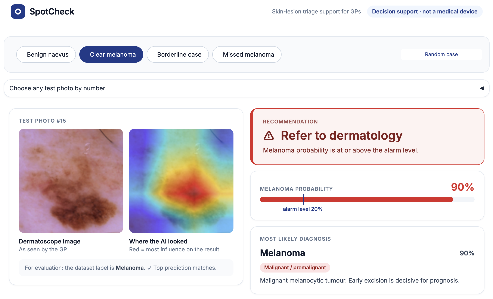

# SpotCheck

**AI-supported triage of skin lesions for general practitioners.**
SpotCheck classifies a dermatoscope image into seven lesion types, recommends whether the patient
should be referred to dermatology, and shows a Grad-CAM heatmap of the image regions behind the decision.

**Khadija Soua, Robin Harris Subiakno** · Introduction to AI, Winter Semester 2026

> [!IMPORTANT]
> SpotCheck is a student project, not a medical device. It must not be used for clinical decisions.

<p align="center"></p>

## Key results

On the held-out test set (2,005 images, 223 melanomas):

| Model | Accuracy | Melanoma sensitivity | Melanomas missed | Benign lesions referred |
|---|---|---|---|---|
| Baseline (always "naevus") | 66.9% | 0.0% | 223 | 0 |
| Plain ResNet-18 | **83.0%** | 63.2% | 82 | 102 |
| Class-weighted ResNet-18 | 77.3% | 68.2% | 71 | 185 |
| Class-weighted, threshold 0.20 (**final**) | – | **80.3%** | **44** | 359 |

Full analysis, confusion matrices and failure cases: **[EVALUATION.md](EVALUATION.md)**.

**Contents:**
[Quick start](#quick-start) ·
[Installation](#installation) ·
[Reproducing the results](#reproducing-the-results) ·
[Project structure](#project-structure) ·
[Method](#method) ·
[Troubleshooting](#troubleshooting) ·
[Team](#team-and-contributions) ·
[AI use](#ai-use-statement) ·
[References](#references)

---

## Quick start

The trained model (`model_weighted.pt`) is included, so the demo runs without training:

```bash
python3 -m venv .venv
source .venv/bin/activate          # Windows: .venv\Scripts\activate
pip install -r requirements.txt
python app.py
```

Open **http://127.0.0.1:7860** in a browser. Start-up takes about a minute, because the app first
analyses all 2,005 test images once. Stop it with `Ctrl + C`.

**In the demo:** choose a case (benign naevus, clear melanoma, borderline case, missed melanoma, or a
random image) to see the recommendation, the heatmap and all seven class probabilities. Drag the
**alarm level** slider to see live how the referral threshold trades detected melanomas against
unnecessary referrals across the whole test set.

## Installation

**Requirements**

- Python 3.12 or newer (developed and tested with Python 3.14 on macOS)
- A standard laptop; no GPU required
- Internet on the first run, to download the dataset and the pretrained ResNet-18 weights (about 45 MB)
- Free, open-source tools only; no paid APIs or accounts

**Setup**

```bash
python3 -m venv .venv
source .venv/bin/activate          # Windows: .venv\Scripts\activate
pip install -r requirements.txt
```

`requirements.txt` pins the exact package versions used to produce the results.

## Reproducing the results

Run the scripts in this order. Each script that opens a figure window finishes only after the
window is closed.

| Step | Command | Output | Time* |
|---|---|---|---|
| 1 | `python explore.py` | Class counts and one example per class (`examples.png`) | 1 min |
| 2 | Set `WEIGHTED = False` in `train.py`, then `python train.py` | Plain model → `model_plain.pt` | ~15 min |
| 3 | Set `WEIGHTED = True` in `train.py`, then `python train.py` | Class-weighted model → `model_weighted.pt` | ~15 min |
| 4 | `python evaluate.py model_plain.pt`<br>`python evaluate.py model_weighted.pt` | Test metrics and confusion matrices | 1 min each |
| 5 | `python threshold.py` | Threshold selection on validation, final check on test | 1 min |
| 6 | `python heatmap.py` | Grad-CAM heatmaps of detected and missed melanomas | 1 min |
| 7 | `python app.py` | Demo website | 1 min |

<sub>*On a MacBook Pro CPU at 128 × 128 pixels. A fixed random seed is used, but results may vary
slightly across hardware and library versions.</sub>

Recorded results and analysis: [EVALUATION.md](EVALUATION.md).
Questions we worked through while building it, with answers: [LEARNING_NOTES.md](LEARNING_NOTES.md).

## Project structure

```
spotcheck/
├── common.py              Shared code: data loading, preprocessing, model, predictions
├── explore.py             Dataset exploration
├── train.py               Fine-tuning ResNet-18 (plain or class-weighted)
├── evaluate.py            Test-set evaluation and confusion matrix
├── threshold.py           Choice of the melanoma referral threshold
├── heatmap.py             Grad-CAM explanations
├── app.py                 Demo website (Gradio)
├── model_plain.pt         Trained plain model
├── model_weighted.pt      Trained class-weighted model (used by the demo)
├── images/                Figures used in EVALUATION.md
├── EVALUATION.md          Evaluation report
├── LEARNING_NOTES.md      Study notes: questions and answers
├── requirements.txt       Pinned package versions
└── README.md
```

## Method

| | |
|---|---|
| **Data** | DermaMNIST (MedMNIST v2), a 7-class version of the HAM10000 dermatoscope dataset; 10,015 images at 128 × 128, official split of 7,007 train / 1,003 validation / 2,005 test; downloaded automatically |
| **Preprocessing** | ImageNet normalisation; random horizontal and vertical flips during training |
| **Model** | ResNet-18 pretrained on ImageNet, final layer replaced by a 7-way linear layer, all layers fine-tuned |
| **Training** | 5 epochs, batch size 64, Adam (learning rate 1e-4), cross-entropy loss; optional inverse-frequency class weights |
| **Model selection** | Epoch with the highest validation balanced accuracy |
| **Referral rule** | Refer when P(melanoma) ≥ 0.20, threshold chosen on the validation set |
| **Explanation** | Grad-CAM on the last convolutional block |

The test set was used only once, after all modelling and threshold decisions were fixed.

## Troubleshooting

| Problem | Fix |
|---|---|
| `CERTIFICATE_VERIFY_FAILED` when downloading the dataset (macOS) | Run `open "/Applications/Python 3.14/Install Certificates.command"` once (use your Python version), then retry |
| A script seems stuck after showing a figure | Close the figure window; the script finishes after it |
| `ModuleNotFoundError` | Activate the virtual environment (the prompt should start with `(.venv)`), then reinstall the requirements |
| Training is slow | Set `SIZE = 64` in `common.py` (results will differ from the report) |
| Port 7860 already in use | Stop the previous `app.py` with `Ctrl + C`, or close the terminal running it |

## Team and contributions

We worked on all parts of the project together: data exploration, model training, evaluation,
threshold analysis, Grad-CAM, the demo website and the presentation. Both of us can explain
every part of the code.

| Member | Contribution |
|---|---|
| Khadija Soua | All parts, jointly |
| Robin Harris Subiakno | All parts, jointly |

## AI-use statement

We used **Claude (Anthropic)** to explain concepts, generate and modify code, debug errors,
design the demo website and structure the documentation. We checked its output by:

- running every script ourselves and recording the outputs (see [EVALUATION.md](EVALUATION.md));
- cross-checking the printed metrics against the confusion matrices by hand;
- reading and documenting every main code section, and recording our questions and the
  answers in [LEARNING_NOTES.md](LEARNING_NOTES.md).

All results in this repository come from our own runs.

## References

- Yang, J. et al. (2023). MedMNIST v2: A large-scale lightweight benchmark for 2D and 3D
  biomedical image classification. *Scientific Data*, 10, 41. [arXiv:2110.14795](https://arxiv.org/abs/2110.14795)
- Tschandl, P., Rosendahl, C. & Kittler, H. (2018). The HAM10000 dataset. *Scientific Data*, 5, 180161.
- He, K., Zhang, X., Ren, S. & Sun, J. (2016). Deep residual learning for image recognition. *CVPR*.
- Selvaraju, R. R. et al. (2017). Grad-CAM: Visual explanations from deep networks via
  gradient-based localization. *ICCV*.
